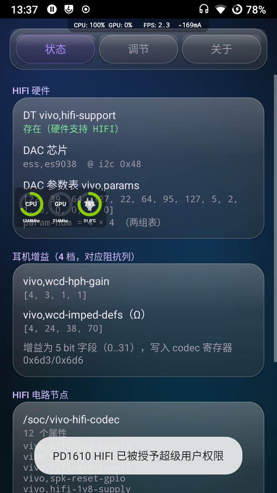
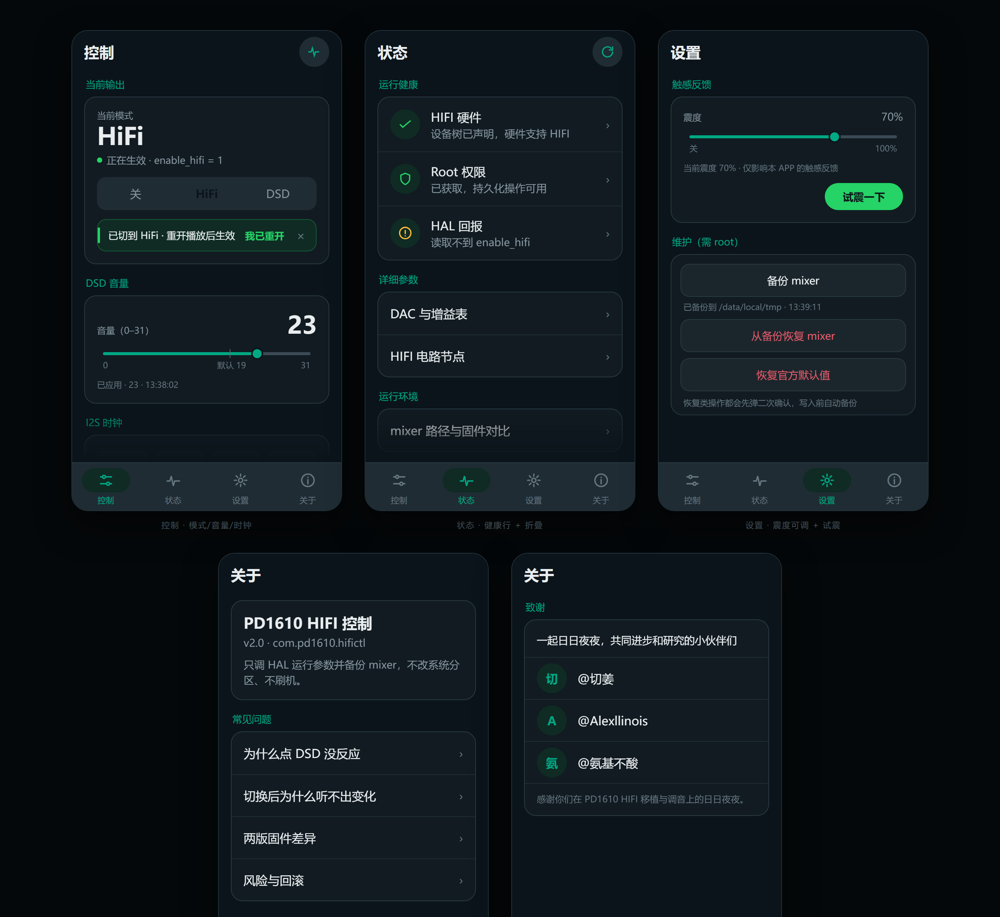

# HifiCtl · HIFI Controller for PD1610

> HIFI tuning tool for vivo Xplay6 (PD1610) on LineageOS 16 / Android 9.
> Evolved from v1.0 to v2.5.4-glass. Pure Java + native Views, no third-party dependencies,
> no system partition modification, no flashing required.

[简体中文 ←](README.md)

---

## What it does

The ES9038 DAC in this old flagship works on LineageOS but never enters the HIFI path.
This app flips the switch that **actually** engages HIFI in the HAL, and surfaces the
hardware parameters read from the device tree:

- **Control**: Off / HiFi / DSD modes, DSD volume (0–31), **audio tuning mode (RX HPH Mode: stock low-power / high-fidelity)**, I2S clock rate.
- **Status**: device-tree DAC model/parameter table/headphone gain/impedance thresholds,
  plus the HAL's current-state readback.
- **Settings**: continuous haptic strength (0–100%), mixer backup/restore, reset to
  defaults (root required for the last two).
- **About**: FAQ, parameter findings, credits.

Key finding (verified on-device, not guessed from `strings`):

> The switch that engages the HIFI path is **`enable_hifi=1`**, not `hifi-playback`.
> After switching you must **restart playback** — the HAL only selects the
> `headphone-hifi` path when opening an output stream.
> **DSD is not a parameter toggle**: it is driven by whether the output stream itself
> is DSD-format. Java `AudioTrack` rejects DSD encoding, so the app never falsely
> reports DSD as active.

## Screenshots

| v1.1 glass (early) | v2.0 redesign |
|---|---|
|  |  |

## Prebuilt APKs

Signed builds from each stage are in `apk/`, ready to install:

| Version | File | Notes |
|---|---|---|
| **v2.5.4-glass** (recommended) | `apk/HifiCtl-v2.5.4-glass.apk` | current: floating liquid-glass bar + long-press magnifier; tuning mode / DSD memory / in-app update retained, versionCode 14 |
| v2.5.3 | `apk/HifiCtl-v2.5.3.apk` | flat-bar stable build: tuning mode + DSD memory + working in-app update, versionCode 12 |
| v2.5 | `apk/HifiCtl-v2.5.apk` | audio tuning mode + DSD memory, versionCode 9 |
| v2.4 | `apk/HifiCtl-v2.4.apk` | in-app update checker, versionCode 8 |
| v2.3 | `apk/HifiCtl-v2.3.apk` | four tabs + haptics + credits, versionCode 7 |
| v1.2 | `apk/HifiCtl-v1.2.apk` | GLES refraction attempt (**deprecated**, crashes; archived only) |
| v1.1-glass | `apk/HifiCtl-v1.1-glass.apk` | stable glass UI, three tabs, device-verified |
| v1.0 | `apk/HifiCtl-v1.0.apk` | initial, parameter names guessed from `strings` (outdated) |

```bash
adb install -r apk/HifiCtl-v2.5.4-glass.apk
```

> The glass variant disables automatic update checks and the update dot, so this internal build
> is not prompted to "upgrade back" to the flat-bar release. Manual check from the top-right entry still works.

## Requirements & permissions

- **In-app updates**: About → Check for updates reads this repo's Releases. "Local" shows
  download progress in-panel and installs via root `pm install -r` (Magisk); "Browser" opens
  the releases page. A top-right button lights up when a newer version exists; check frequency
  is configurable (off / daily default / every launch).
- **No root needed** to toggle HIFI: only `MODIFY_AUDIO_SETTINGS`.
- **Root/Magisk needed** for device-tree reads and mixer backup/restore under
  `/vendor/etc/`. First launch triggers a su prompt.
- Target: Android 9 / API 28 (`minSdk 27`, `targetSdk 28`), 720×1280 and up.
- HAL requirement: `audio.primary.msm8996.so` must support the `enable_hifi` key
  (verified on the PD1610 stock prebuilt kernel).

## Build

No Gradle / AndroidX / Kotlin — just a standard Android SDK:

```bash
export ANDROID_SDK=/path/to/android-sdk   # with build-tools/<ver>/ and platforms/android-28/
bash build.sh
# output: out/HifiCtl.apk
adb install -r out/HifiCtl.apk
```

`build.sh` derives tool paths from environment variables; nothing is hard-coded to a
local machine. Signing uses the bundled generic `app/debug.keystore` (Android's default
debug key, password `android`, development use only).

## Layout

```
.
├─ app/
│  ├─ AndroidManifest.xml
│  ├─ debug.keystore
│  ├─ res/                     # launcher icons (5 densities)
│  ├─ assets/avatars/          # about-page credit avatars
│  └─ src/com/pd1610/hifictl/  # 19 Java classes
│     ├─ MainActivity.java     entry, four-tab shell + back stack
│     ├─ HifiController.java   HAL setParameters / modes / mixer backup (core)
│     ├─ DtReader.java         big-endian u32 device-tree property reader
│     ├─ RootShell.java        su execution wrapper
│     ├─ ControlPage / StatusPage / SettingsPage / AboutPage.java
│     └─ Wds / Widgets / Icons / Rows / ... design system & components
├─ docs/
│  ├─ 01_实测结论_HAL参数.md   on-device parameter verification, DSD limits, audio evidence
│  ├─ 02_UI设计规范_v20.md     v2.0 Wupp-style design spec
│  └─ 03_设计与实现.md         early design & implementation notes
├─ screenshots/
├─ apk/                        prebuilt APKs from each stage
└─ build.sh
```

## Version history

| Version | When | Change |
|---|---|---|
| v1.0 | 11-17 AM | initial three pages, `hifi-playback` guessed from strings (ineffective) |
| v1.1-glass | 11-17 13:15 | corrected to `enable_hifi`, glass UI, device-verified |
| v1.2 | 11-17 18:05 | GLES refraction + bottom nav attempt → **crashes, deprecated** |
| v2.0 | 11-17 22:00 | full rewrite: Wupp/WhatsApp dark theme, four tabs, haptics, confirm sheet, serialized HAL writes |
| v2.3 | 11-17 22:28 | about-page credits and avatars |
| v2.4 | 11-17 23:40 | in-app updates: local (in-panel download progress + root silent install) / browser (open releases); top-right check-frequency setting (daily default, off / every launch); downgrade guard |
| v2.5.4-glass | 11-18 11:02 | floating liquid-glass bottom bar (blurred backdrop + pill indicator + long-press magnifier), business layer unchanged; auto update check disabled to avoid prompting an upgrade back to the flat release, versionCode 14 |
| v2.5 | 11-18 00:13 | audio tuning mode on the control page (RX HPH Mode: stock low-power CLS_H_LP / high-fidelity CLS_H_HIFI, takes effect instantly, restored at boot via Magisk service.d); fixed DSD falling back to HiFi after restart (remembers the last mode and labels it honestly) |

## Known limitations

1. **DSD cannot be triggered by a parameter**: `DSDEnable` proved ineffective; requires a
   native DSD-output player plus a real DSD source.
2. `dsdvol_index` / `hifi_i2s_clock_rate` return success but have no HAL readback; their
   actual audio impact has not been blind-tested.
3. HIFI ON raises headphone volume by 4 steps (16→20) — align loudness before A/B
   comparison, or "louder" gets mistaken for "better".
4. Restart playback after switching HIFI for it to take effect.

## Credits

- [AlexIllinois2](https://github.com/AlexIllinois2) — co-contributor. The HIFI path and
  parameter porting approach came from [xplay6-tmproot](https://github.com/AlexIllinois2/xplay6-tmproot);
  every release page from v1.0 to v2.5.4-glass carries this credit.

## License

Code: Apache-2.0. Credit avatars and nicknames belong to their respective owners,
displayed only in the app's About page.
