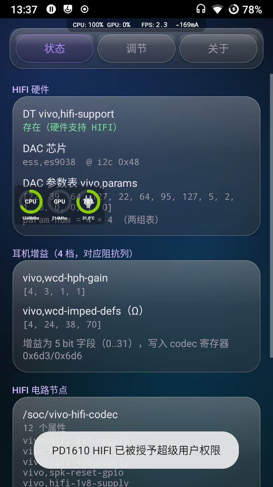
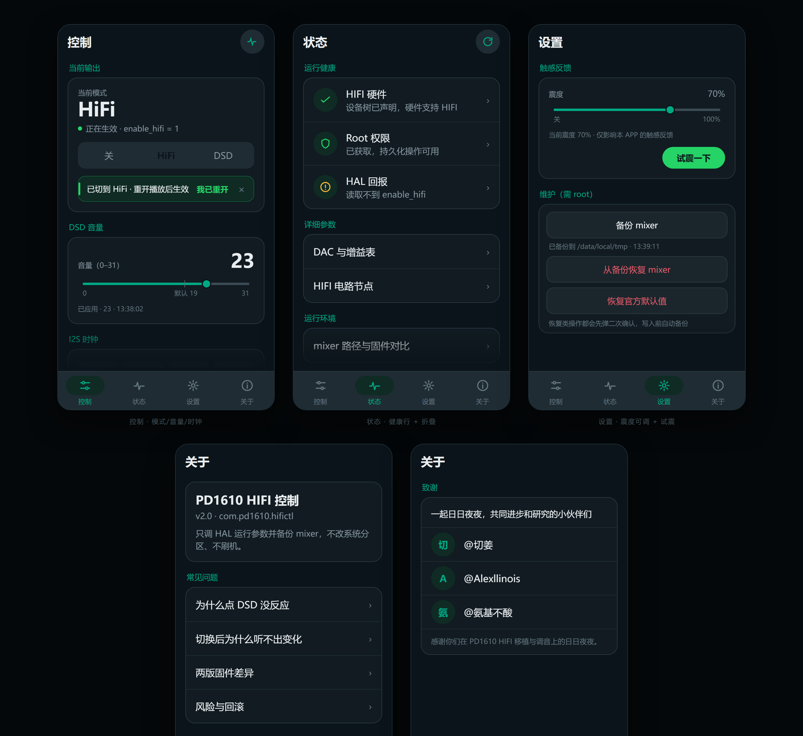

# HifiCtl · PD1610 HIFI 控制器

> vivo Xplay6 (PD1610) / LineageOS 16 / Android 9 上的 HIFI 音效调节工具。
> 从 v1.0 一路迭代到 v2.3，纯 Java + 原生 View，无第三方依赖、不改系统分区、不刷机。

[English ↓](#english)

---

## 这是什么

一台老旗舰的 HIFI 芯片（ES9038 DAC）在 LineageOS 上"能出声但没走 HIFI 通路"。
这个 APP 做的是**把 HAL 里那个真正生效的开关打开**，并把设备树里的硬件参数显示出来：

- **控制**：Off / HiFi / DSD 模式切换、DSD 音量（0–31）、**音质档（耳放工作模式：官方省电 / 高保真）**、I2S 时钟档位
- **状态**：读 device tree 的 DAC 型号/参数表/耳机增益/阻抗阈值，显示 HAL 回报的当前状态
- **设置**：触感强度连续可调（0–100%）、mixer 备份/恢复、恢复默认值（需 root）
- **关于**：常见问题、参数有效性结论、致谢、应用内版本更新

关键结论（实机验证，不是看 `strings` 猜的）：

> 真正让 HIFI 通路生效的是 **`enable_hifi=1`**，不是 `hifi-playback`。
> 切换后必须**重新开始播放**才会走 `headphone-hifi` 路由（HAL 在开流时才选 path）。
> **DSD 档不是参数开关**——由输出流本身是否为 DSD 格式决定，Java `AudioTrack` 不支持 DSD 编码，本 APP 不谎报 DSD 生效。

## 截图

| v1.1 玻璃态（早期） | v2.0 重构设计稿 |
|---|---|
|  |  |

## 预编译 APK

`apk/` 目录保留了各阶段的签名产物，可直接用：

| 版本 | 文件 | 说明 |
|---|---|---|
| **v2.5.3**（推荐） | `apk/HifiCtl-v2.5.3.apk` | 当前版：音质档 + DSD 记忆 + 可用的应用内更新，versionCode 12 |
| v2.5.2 | `apk/HifiCtl-v2.5.2.apk` | 同 v2.5.3（去调试日志前），versionCode 11 |
| v2.5.1 | `apk/HifiCtl-v2.5.1.apk` | 修复更新面板按钮，versionCode 10 |
| v2.5 | `apk/HifiCtl-v2.5.apk` | 音质档 + DSD 记忆，versionCode 9 |
| v2.4 | `apk/HifiCtl-v2.4.apk` | 应用内版本更新，versionCode 8 |
| v2.3 | `apk/HifiCtl-v2.3.apk` | 四页签 + 触感 + 致谢，versionCode 7 |
| v1.2 | `apk/HifiCtl-v1.2.apk` | GLES 折射尝试版（**已废弃**，会闪退，仅留档） |
| v1.1-glass | `apk/HifiCtl-v1.1-glass.apk` | 玻璃态稳定版（三页签，已实机验证） |
| v1.0 | `apk/HifiCtl-v1.0.apk` | 初版，参数名按 `strings` 推断（已过时） |

```bash
adb install -r apk/HifiCtl-v2.5.3.apk
```

## 权限与前提

- **应用内更新**：关于页「检查更新」读取本仓库 Releases；「本地更新」在面板内显示下载进度并通过 root 后台静默安装（需 Magisk），**下载走 `api.github.com` 的 asset 接口，不需要能打开 github.com**；「浏览器更新」跳发布页，需要能打开 github.com（打不开请挂代理）。右上角常驻更新按钮，发现新版本时圆点亮起，可设检查频率（关闭 / 每日一次 / 每次打开）。
- **不需要 root** 也能切 HIFI：只需 `MODIFY_AUDIO_SETTINGS`。
- **需要 Magisk/root**：读 device tree、`/vendor/etc/` 下的 mixer 备份与恢复。首次启动会弹授权。
- 目标机：Android 9 / API 28（`minSdk 27` / `targetSdk 28`），720×1280 起。
- 依赖 HAL：`audio.primary.msm8996.so` 需支持 `enable_hifi` 这个 key（PD1610 原厂 prebuilt 内核验证过）。

## 编译

无需 Gradle / AndroidX / Kotlin，只要一个标准 Android SDK：

```bash
export ANDROID_SDK=/path/to/android-sdk   # 含 build-tools/<ver>/ 与 platforms/android-28/
bash build.sh
# 产物 out/HifiCtl.apk
adb install -r out/HifiCtl.apk
```

`build.sh` 从环境变量推导工具路径，不写死本机目录。签名用仓库自带的通用 `app/debug.keystore`
（android 默认调试密钥，密码 `android`，仅开发用途）。

## 目录

```
.
├─ app/
│  ├─ AndroidManifest.xml
│  ├─ debug.keystore
│  ├─ res/                     # 启动图标（5 档密度）
│  ├─ assets/avatars/          # 关于页致谢头像
│  └─ src/com/pd1610/hifictl/  # 19 个 Java 类
│     ├─ MainActivity.java     入口，四页签骨架 + 返回键栈
│     ├─ HifiController.java   HAL setParameters / 模式切换 / mixer 备份（核心）
│     ├─ DtReader.java         大端 u32 读 device tree 属性
│     ├─ RootShell.java        su 执行封装
│     ├─ ControlPage/StatusPage/SettingsPage/AboutPage.java  四个页面
│     └─ Wds.java / Widgets.java / Icons.java / Rows.java / ... 设计系统与组件
├─ docs/
│  ├─ 01_实测结论_HAL参数.md   enable_hifi 验证、DSD 三层限制、音质客观证据
│  ├─ 02_UI设计规范_v20.md     v2.0 Wupp 风格设计规格（色板/组件/交互）
│  └─ 03_设计与实现.md         早期设计与实现全过程
├─ screenshots/                实机截图与设计稿
├─ apk/                        各阶段预编译 APK
└─ build.sh                    一键构建
```

## 版本演进

| 版本 | 时间 | 变化 |
|---|---|---|
| v1.0 | 11-17 上午 | 初版三页，`hifi-playback` 按 strings 推断（实测无效） |
| v1.1-glass | 11-17 13:15 | 修正为 `enable_hifi`，玻璃态 UI，实机三页验证通过 |
| v1.2 | 11-17 18:05 | GLES 折射 + 底部导航尝试 → **闪退，废弃** |
| v2.0 | 11-17 22:00 | 整体重构：Wupp/WhatsApp 深色系、四页签、触感可调、确认层、HAL 写串行化 |
| v2.3 | 11-17 22:28 | 完善关于页致谢与头像 |
| v2.4 | 11-17 23:40 | 关于页新增「版本更新」：本地更新（面板内下载进度 + root 静默安装）/ 浏览器更新（打开发布页）；右上角可设检查频率（默认每日一次，可关闭 / 每次打开）；降级保护 |
| v2.5.3 | 11-18 00:32 | 修复应用内自动安装（setsid 独立会话，避免安装本 APP 时进程被杀导致中断）；本地更新走 api.github.com |
| v2.5.2 | 11-18 00:28 | 合并 v2.5/v2.5.1 修复的正式版 |
| v2.5.1 | 11-18 00:25 | 修复更新面板按钮 0 宽点不到；下载改走 API asset 接口 |
| v2.5 | 11-18 00:13 | 控制页新增「音质档」（RX HPH Mode 两档：官方省电 CLS_H_LP / 高保真 CLS_H_HIFI，立即生效，Magisk service.d 开机自恢复）；修复 DSD 档重开后退回 HiFi 的显示问题（记住上次档位并如实标注） |

## 已知限制

1. **DSD 档不可由参数触发**：`DSDEnable` 实测无效；需原生 DSD 输出播放器 + 真实 DSD 音源。APP 会记住你选的 DSD 档并如实标注，但 HAL 里只有 `enable_hifi=1`。
2. `dsdvol_index` / `hifi_i2s_clock_rate` 调用返回成功但 HAL 无 readback，实际音质影响未做双盲听测。
3. HIFI ON 时耳机音量自动 +4 档（16→20），A/B 对比需先对齐响度，否则会把"更响"误判成"音质更好"。
4. 切换 HIFI 后需重开播放才生效。
5. **两版原厂固件的 HIFI 通路参数逐字节相同**（差异只是 MultiMedia3→8 等平台通路编号），不存在"两版调音"；能改变听感的是控制页「音质档」的耳放工作模式。
6. 音质档依赖 Magisk 模块提供的 `tinymix`（`/data/adb/modules/audio_pd1610/tinymix`）；高保真档耗电略高。

## 许可

代码 Apache-2.0；致谢头像与昵称版权归各自作者，仅在本 APP 关于页展示使用。

---

<a name="english"></a>
## English

**HifiCtl** — HIFI control app for vivo Xplay6 (PD1610) on LineageOS 16 / Android 9.
Pure Java, native Views, no third-party dependencies. Does not touch system partitions or root by default.

- **Control**: Off / HiFi / DSD, DSD volume, I2S clock rate.
- **Status**: device-tree parameters (ES9038 DAC, headphone gain, impedance) and HAL readback.
- **Settings**: haptic strength, mixer backup/restore, reset defaults (root required for the last two).
- **About**: FAQ, parameter findings, credits.

**Key finding (verified on-device, not guessed from `strings`):** the switch that actually
engages the HIFI path is `enable_hifi=1`, not `hifi-playback`. Restart playback after
switching — the HAL selects the `headphone-hifi` path only when opening an output stream.
DSD is **not** a parameter toggle: it is triggered by the output stream's own format, and
Java `AudioTrack` rejects DSD encoding, so the app never falsely reports DSD as active.

**Build:** `export ANDROID_SDK=/path/to/sdk && bash build.sh`. No Gradle/Kotlin/AndroidX.
**Install:** `adb install -r apk/HifiCtl-v2.3.apk` (prebuilt, signed with the bundled debug key).

**Versions:** v1.0 (initial, wrong parameter) → v1.1-glass (correct `enable_hifi`, glass UI)
→ v1.2 (GLES, deprecated/crashes) → v2.0 (Wupp-style rewrite, four tabs) → **v2.3 (current)**.

See [docs/01](docs/01_实测结论_HAL参数.md) for the full parameter investigation,
[docs/02](docs/02_UI设计规范_v20.md) for the design system.

Licensed under Apache-2.0; credit avatars belong to their respective owners.
